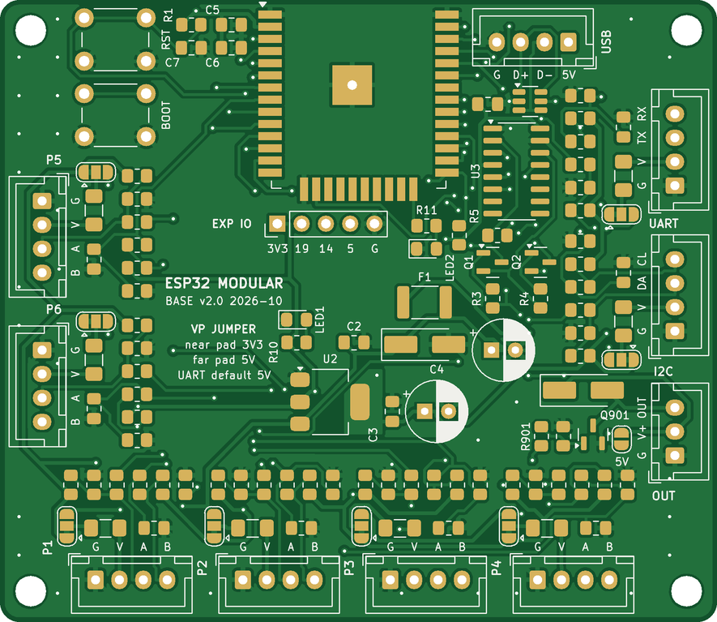

# Modular ESP32 board (ESP32 Modular Base v2.0)

An open-hardware ESP32 carrier for Home Assistant / ESPHome. It has 8 JST XH 4-pin ports:

- **P1–P6**: general ports, each with a digital pin **A** and an input/analog pin **B**
- **UART**: 5 V serial port for meters and RS485 modules
- **I2C**: sensor bus with pull-ups fitted

There is also a switched output (**OUT**) for 12–24 V loads. Every general port has the same set of empty resistor footprints; you fit a few to match the job:

- **Generic jobs:** relays, buttons and dry contacts, temperature probes, 0–3.3 V analog signals, pulse and flow meters, energy meters, RS485 Modbus devices, I2C sensors and displays, 12–24 V loads (SSR, LED strip, fan, buzzer)
- **Popular parts:** 1–8 channel relay modules, DS18B20, NTC 10 k thermistors, YF-S201 / YF-B flow sensors, PZEM-004T v3, MAX485 modules, BME280, SHT3x / SHT4x, BH1750, ADS1115, SSD1306 OLED, capacitive soil moisture sensors

> **Status: v2.0 PCBs received from Seeed Studio (2026-11-05), not yet built or tested.**
> The picture below is rendered from the Gerbers, not a photo. Real photos and a test report will be added after bring-up.



## Features

- Ai-Thinker ESP-32S / ESP32-WROOM-32 module, USB (CH340C) with auto-reset, BOOT/RESET buttons, status LED
- 75 × 65 mm, 2 layers, hand-solderable (0805, 1206, SOT-23/223, SOIC-16, THT)
- Also suitable for machine assembly: standard SMD packages, assembly files for JLCPCB / PCBWay in `production/pcba/`
- 6 general ports P1–P6 (G, VP, A, B), UART port (5 V, RX divider for 5 V devices), I2C port (pull-ups fitted)
- OUT: low-side MOSFET switch with flyback diode, about 2 A / 24 V, PWM-capable
- Per port: VP jumper (3.3 V / 5 V), 0.5 A PTC, series resistors, empty footprints for pull-ups, pull-downs, divider and filter
- **Low voltage only.** No mains on the PCB. Mains devices (e.g. PZEM-004T, relay boards) stay in their own enclosure section behind a divider. Flash and probe the board with mains disconnected.

## Pin map

| Port | A (pin 3) | B (pin 4) | Notes |
|---|---|---|---|
| P1 | GPIO25 | GPIO36 | B input-only, ADC1. No pulse counting on GPIO36 |
| P2 | GPIO26 | GPIO39 | B input-only, ADC1. No pulse counting on GPIO39 |
| P3 | GPIO27 | GPIO34 | B input-only, ADC1 |
| P4 | GPIO13 | GPIO35 | B input-only, ADC1 |
| P5 | GPIO4 | GPIO32 | B bidirectional, ADC1 |
| P6 | GPIO18 | GPIO33 | B bidirectional, ADC1 |
| UART | TX GPIO17 | RX GPIO16 | VP = 5 V, RX through 10 k / 22 k divider |
| I2C | SDA GPIO21 | SCL GPIO22 | 4.7 k pull-ups fitted |
| OUT | GPIO23 → AO3400A | | XH 3P: G, V+, OUT |
| Fixed | GPIO0 BOOT, GPIO1/3 USB serial, GPIO2 status LED | | |

Connector pins: 1 GND, 2 VP, 3 A, 4 B (JST XH 2.54 mm, pin 1 = square pad).

## Port recipes

Fit the parts for the job, then use the matching ESPHome component.

| Job | Pin | VP | Fit | ESPHome |
|---|---|---|---|---|
| Relay module, low trigger | A | 3V3 | defaults | `switch: gpio`, `inverted: true` |
| Relay module, high trigger | A | 3V3 | + RAD 10 k | `switch: gpio` |
| DS18B20 | A | 3V3 | + RAU 4.7 k | `one_wire` + `dallas_temp` |
| Button / dry contact | A | – | internal pull-up (or RAU 10 k) | `binary_sensor: gpio` |
| NTC 10 k B3950 | B | – | + RBU 10 k 1 %, CB 100 nF | `adc` → `resistance` → `ntc` |
| 0–3.3 V analog | B | as needed | + CB 100 nF | `adc` |
| 5 V pulse (flow sensor) | B on P3–P6 | 5V | RB → 10 k, + RBD 22 k, CB 1 nF | `pulse_counter` |
| Open-collector pulse | A | 5V | + RAU 10 k | `pulse_counter` |
| PZEM-004T | UART | 5V | defaults | `uart` + `modbus` + `pzemac` |
| RS485 Modbus | UART + P5/P6 B (DE/RE) | 5V | remove R706 for a 3.3 V module | `modbus` with `flow_control_pin` |
| I2C sensors | I2C | 3V3 | defaults | `i2c` + sensor |
| SSR / LED strip / fan / buzzer | OUT | load supply | defaults | `output: ledc` or `gpio` |

Part names per port (n = port number, 7 = UART, 8 = I2C): Rn01 RA series, Rn02 RAU, Rn03 RAD, Rn04 RB series, Rn05 RBU, Rn06 RBD, Cn01 CB. Full details: the "Port options" sheet in [the BOM workbook](hardware/bom/esp32-modular-v2.0-BOM.xlsx) and page 13+ of the assembly guide.

## Build one

**Bare PCB:** upload [`hardware/fabrication/esp32-modular_gerbers.zip`](hardware/fabrication/esp32-modular_gerbers.zip) to JLCPCB, PCBWay or Seeed Fusion: 2 layers, 75 × 65 mm, 1.6 mm, 1 oz, HASL lead-free (ENIG is nicer for the module's castellated pads). All rules are within the standard tier.

**Hand assembly:**
- [Assembly guide (A4 PDF, 17 pages)](hardware/docs/assembly_guide.pdf): one page per soldering step, inspection and test pages
- [Interactive BOM](hardware/docs/ibom_assembly.html): download it and open it in a browser, then click a part to see where it goes
- [BOM workbook](hardware/bom/esp32-modular-v2.0-BOM.xlsx) and [BOM app](hardware/bom/bom-app.html) (offline shopping list: stock, shops, number of boards)
- [Schematic (PDF)](hardware/docs/schematic.pdf)

**Assembled by the fab (PCBA):** JLCPCB and PCBWay BOM and position files are in [`production/pcba/`](production/pcba/README.md). They cover the 54 SMD parts; you hand-solder the 14 THT parts (XH sockets, buttons, electrolytics) or pay JLCPCB for THT assembly. The fab build uses an ESP32-WROOM-32E-N4 instead of the Ai-Thinker ESP-32S. All LCSC numbers were checked on JLCPCB (2026-11-05). **Before ordering:** confirm part rotations in JLCPCB's placement preview (see that README).

## Firmware

ESPHome packages in [`firmware/`](firmware/README.md): one package per port job (relay, dry contact, DS18B20, NTC, analog, pulse flow, PZEM-004T, RS485 Modbus, I2C + BME280, OUT PWM / switch), a common `base.yaml` with the board pins as substitutions, and three examples (`test-board`, `energy-relay`, `greenhouse`).

Pick the job, fit the parts from the recipe above, then include the package with the port pin:

```yaml
packages:
  base: !include ../base.yaml
  pump_p1: !include
    file: ../packages/relay.yaml
    vars: {id: pump_p1, name: Pump, pin: "${p1_a}"}
```

Every example passes `esphome config` on ESPHome 2026.10.2 (ESP-IDF framework). Not yet run on a built board. New board: flash `firmware/examples/test-board.yaml` first (assembly guide page 13).

## Open items

- [ ] **PCBA:** confirm every part's rotation and pin 1 in JLCPCB's placement preview before any assembled order (see [`production/pcba/README.md`](production/pcba/README.md)).
- [ ] **Flow sensors:** set `pulses_per_litre` for each flow sensor model used. One board set can use different models, so set it per sensor (typical values in [`firmware/README.md`](firmware/README.md#flow-sensor-factors)).
- [ ] **Device sets:** the examples are starting points. Write one device config per board set (which devices on which ports), named after the board (e.g. `b1-boiler.yaml`).

## Repository

| Folder | Contents |
|---|---|
| `firmware/` | ESPHome packages and example configs. See [firmware/README.md](firmware/README.md) |
| `hardware/` | KiCad 7 project, custom footprint library, generator scripts (`tools/`), BOM (`bom/`), docs and Gerbers. See [hardware/README.md](hardware/README.md) |
| `production/pcba/` | JLCPCB / PCBWay BOM and position files, generated by `hardware/tools/pcba.py` |
| `LICENSES/` | Licence texts |

The KiCad files are generated by Python scripts (`hardware/tools/`): `parts.py` and `design.py` are the source of truth. Rebuild steps and the toolchain (KiCad 7, Freerouting 1.9.0, InteractiveHtmlBom, …) are in [hardware/README.md](hardware/README.md). KiCad 8/9 open the files and upgrade them on save.

## Known caveats

- Hardware not yet built or tested. Faults found during bring-up will be logged in [CHANGELOG.md](CHANGELOG.md) and the issues.
- Electrical check done with a netlist pin-type script (`erc_lite.py`), not a full KiCad GUI ERC. Expected finding: CH340C V3 and AMS1117 output both on +3V3 (CH340C 3.3 V mode).
- Six reference designators are hidden on the silkscreen for lack of room. The iBOM and assembly guide show all of them.
- Iron temperatures and test values in the assembly guide are general guidance, not measurements from a built board.

## Licence

| What | Licence |
|---|---|
| Hardware design (KiCad files, footprints, Gerbers) | [CERN-OHL-S-2.0](LICENSES/CERN-OHL-S-2.0.txt) |
| Scripts and firmware | [MIT](LICENSES/MIT.txt) |
| Documentation and images | [CC BY-SA 4.0](LICENSES/CC-BY-SA-4.0.txt) |

© 2026 stefangrozdanovski-sys. Freerouting (used to route the board, downloaded by `hardware/tools/get_freerouting.sh`) is GPL-3.0 and not included.
