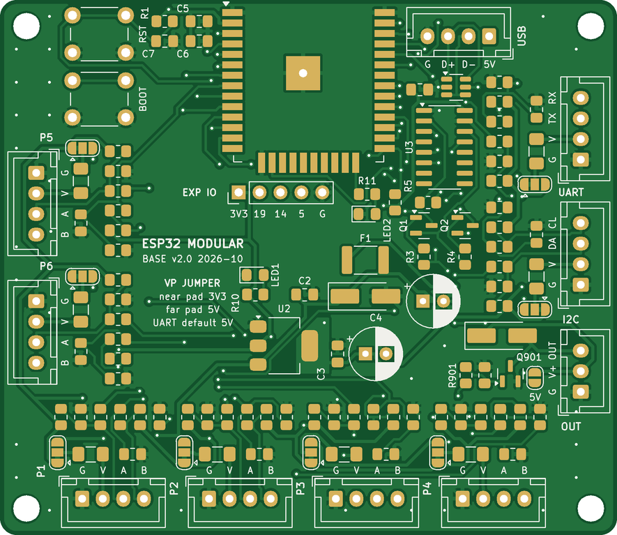

# ESP32 Modular Base v2.0: hardware

75 × 65 mm, 2 layers, 1.6 mm FR-4. Hand-solderable (0805, 1206, SOT-23/223, SOIC-16, THT).
Low-voltage board only: USB 5 V in, no mains on the PCB.



## Connectors

| Edge | Connector | Pins (pin 1 = square pad) |
|---|---|---|
| Top-right | J1 USB in (XH 4P) | 5V, D−, D+, G (from the bare USB-C breakout, A-to-C cable) |
| Bottom | P1–P4 (J101–J401, XH 4P) | G, VP, A, B |
| Left | P5, P6 (J501, J601, XH 4P) | G, VP, A, B |
| Right | UART (J701), I2C (J801), XH 4P | G, VP, TX, RX / G, VP, SDA, SCL |
| Right | OUT (J901, XH 3P) | G, V+, OUT |
| Under module | EXP (J902, 1×5 2.54 mm, not fitted) | 3V3, IO19, IO14, IO5, G |
| Top-left | RESET, BOOT buttons | |

## Pin map

| Port | A (pin 3) | B (pin 4) | Notes |
|---|---|---|---|
| P1 | IO25 | IO36 | B input-only, ADC1. No pulse counting on IO36 |
| P2 | IO26 | IO39 | B input-only, ADC1. No pulse counting on IO39 |
| P3 | IO27 | IO34 | B input-only, ADC1 |
| P4 | IO13 | IO35 | B input-only, ADC1 |
| P5 | IO4 | IO32 | B bidirectional, ADC1 |
| P6 | IO18 | IO33 | B bidirectional, ADC1 |
| UART | TX IO17 | RX IO16 | RX through 10k/22k divider (5 V devices) |
| I2C | SDA IO21 | SCL IO22 | 4.7 k pull-ups fitted |
| OUT | IO23 → AO3400A | | low-side, SS34 flyback to V+, about 2 A / 24 V |
| Fixed | IO0 BOOT, IO1/IO3 CH340C, IO2 status LED | | |

The port map is also printed on the back of the board.

## Port options (same in every port, n = port number, 7 = UART, 8 = I2C)

| Ref | Position | Default |
|---|---|---|
| JPn01 | VP jumper: pad next to the connector = 3V3, far pad = 5V | 3V3 (UART: 5V), bridged by a trace |
| Fn01 | 0.5 A PTC on VP | fitted |
| Rn01 | A series | 330 R |
| Rn02 / Rn03 | A pull-up to 3V3 / pull-down to GND | empty |
| Rn04 | B series | 1 k |
| Rn05 | B pull-up to 3V3 (connector side) | empty |
| Rn06 / Cn01 | B to GND (GPIO side): divider bottom / filter | empty |

To change a VP jumper: cut the thin trace between the bridged pads, then bridge the other side with solder.
Recipes for each job (relay, NTC, DS18B20, flow sensor, PZEM, I2C) are on the "Port options" sheet of `bom/esp32-modular-v2.0-BOM.xlsx`.

## Buying the parts

Open `bom/bom-app.html` in your browser (works offline). Enter what you have in stock, set the number of boards, choose the shop per part, then open the Shopping list tab and print it on A4. Everything is saved in that browser; use Export backup to keep a copy. Rebuild it with `python3 bom/build_bom_app.py bom/bom-app.html` after the BOM changes.

## Ordering

Upload `fabrication/esp32-modular_gerbers.zip` to PCBWay or JLCPCB: 2 layers, 75 × 65 mm, 1.6 mm, 1 oz, HASL lead-free (ENIG is nicer for the castellated module).
Rules used: 0.2 mm clearance, 0.3 mm signal / 0.4 mm power tracks, 0.7/0.35 mm vias (tented), 0.5 mm copper to edge. All within the standard tier.

## Assembly order

Print `docs/assembly_guide.pdf` (17 A4 pages): one page per soldering step with the parts highlighted on a board drawing, tick boxes for boards B1–B5, inspection, test pages with measurement columns, port options, jumper how-to, a board record and a parts index.

Open `docs/ibom_assembly.html` in a browser: click a BOM line and its parts light up on the board (pin 1 marked). Tick Sourced / Placed as you go; the ticks are remembered in that browser. Empty option footprints are not listed.

1. Fine pitch first, board flat: U3 CH340C, U4 USBLC6, Q1, Q2, Q901, U2 AMS1117.
2. 0805 / 1206 parts: the core first, then each port's fitted parts (Rn01 330 R, Rn04 1 k, Fn01 PTC, plus R706 22 k, R704 10 k, R802/R805 4.7 k).
   Leave the option footprints empty until you know what goes on that port.
3. D1 SMAJ5.0A and D901 SS34 (band toward +5V / V+), F1, LEDs (cathode toward GND).
4. U1 ESP-32S: tin pad 1, align, tack pads 1 and 38, check, then drag-solder. Optionally solder the centre GND pad through the hole from the back.
5. THT: SW1/SW2, C1/C4 (mind the +), XH sockets.

## Bring-up

1. Unpowered: +5V–GND and +3V3–GND are not shorted.
2. Power from USB: +5V ≈ 4.9–5.1 V, +3V3 = 3.25–3.35 V, red LED on.
3. Plug into a PC: the CH340 appears as a serial port. Flash ESPHome; auto-reset handles boot mode (or hold BOOT, tap RESET).

## Verification done

- Netlist vs `tools/design.py`: 73 nets, 119 parts, 0 differences. Pin-type electrical check: only the documented CH340C 3.3 V mode finding.
- KiCad 7 DRC: 0 violations, 0 unconnected items, 0 footprint errors.
- PCB vs schematic: all 325 pads carry the schematic's net.
- Gerbers re-read with gerbv; `docs/board_top.png` / `board_bottom.png` are rendered from the Gerbers.

## Rebuilding (tools/)

`parts.py` (values, footprints, fit) and `design.py` (nets) are the source of truth; `layout.py` holds the board geometry and placement.

```
python3 tools/gen_sch.py esp32-modular.kicad_sch
kicad-cli sch export netlist -o net.net esp32-modular.kicad_sch
python3 tools/check_net.py net.net && python3 tools/erc_lite.py net.net
python3 tools/build_pcb.py net.net placed.kicad_pcb
python3 tools/silk_fix.py placed.kicad_pcb silk.kicad_pcb --keepout
bash tools/get_freerouting.sh                                    # once: downloads Freerouting 1.9.0 (GPL-3.0)
python3 tools/route.py silk.kicad_pcb routed.kicad_pcb 60        # Freerouting 1.9.0, optimizer off
python3 tools/finish.py routed.kicad_pcb fin.kicad_pcb drc.txt --stitch
python3 tools/polish.py fin.kicad_pcb esp32-modular.kicad_pcb net.net
python3 tools/verify_pcb.py esp32-modular.kicad_pcb net.net drc.txt
bash tools/export.sh .
python3 tools/board_geom.py esp32-modular.kicad_pcb docs/assembly/geom.json
python3 tools/assembly_book.py docs/assembly/geom.json docs/assembly/assembly_guide.html
python3 tools/print_pdf.py docs/assembly/assembly_guide.html docs/assembly_guide.pdf     # A4 assembly guide
bash tools/make_ibom.sh . net.net                                # docs/ibom_assembly.html
python3 tools/gerber_render.py fabrication/gerbers docs/board_top.png docs/board_bottom.png
python3 bom/build_bom.py bom/esp32-modular-v2.0-BOM.xlsx
```

In a bare Python session set `KICAD7_FOOTPRINT_DIR=/usr/share/kicad/footprints`. Remove the `silk: no vias` rule areas after routing (done before saving the project board).
